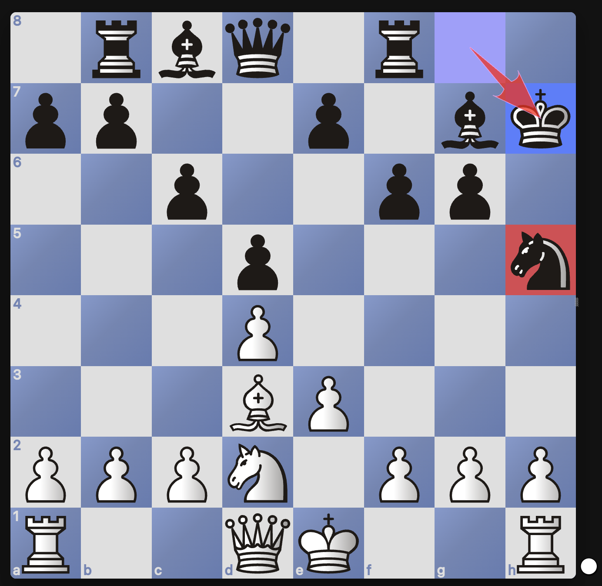

### Five chess pieces of advice I live by 

Throughout the course of my chess content creation journey, many of you have asked me, either on Twitch, Instagram, or in real life, a simple, yet loaded question: 
> How do I get better at chess? 

Today, I have chosen the top five things I think make the most difference when it comes to improving your play. Make sure you let me know which one you've found the most helpful, I'm curious ☺️

1. If you are under 1000, your main focus should be not making one-move mistakes 
I know that it's really tempting to start learning gambits and schemes in order to finally break into the four digits. But, in my opinion, the harsh truth is that so many games at the under 1000 level are lost through one move mistakes. Either your opponent threatens a piece or a mate and you don't see, or you move your piece somewhere where it's vulnerable or straight up hanging. Have a look at your last 10 games. If you can honestly say that in none of those games you didn't either blunder a piece or eat a threat, than this point is not for you. But if you are guilty of the occasional piece blunder, that needs to be your main area of improvement. You should be able to play game after game in which you don't miss any attacks from your opponent, and you don't hang any of your pieces. Make it as an objective to achieve this at least five games in a row, on separate occasions. Just like with pattern recognition, that I will dive into later in this post, if you make your brain always check for one-move threats, at some point it will switch to doing it for you. It doesn't matter if you lose those games that you play while targeting this objective. Once you fix the one-move mistake, a sea of improvement possibilities opens up in front of you, part of it discussed in my next points. 

2. Come up with a story for your opponent's last move 
Like I said before, a lot of games are lost by missing out on threats. Therefore, each time your opponent makes a move, you need to have an understanding, as much as possible, of what prompted them to make that move. If you were in their position, why would you have played that move? This does not mean that you always need to be reactive. Sometimes your opponent intends to do something that is not worth addressing. You shouldn't reach to everthing your opponent is doing, but you should be, as much as possible, aware of what they are doing. 
Besides allowing you to notice your opponent's threat, studying their last move can give another valuable feedback: the consequence of their last move. A move can change the position in a way that finally allows you to do that thing you've been waiting for, or introduce a new weakness that you can exploit. Let's look at an example: 

3. Solving puzzles & the build of pattern recognition 
I know, I know, you've had people tell you to solve puzzles a million times already. Please don't close the tab before I make my point! I have taught chess for more than two years, and most people who never solved puzzles always brought up the same two arguments:
- "That stuff never happens in my games"
or 
- "It's easy to find a sacrifice or a mate when you know that you're doing a puzzle" 
Let's address these comments one by one. 
"That stuff never happens in my games" 
Doesn't it? Or are you just missing it? Many games are lost in one of these two ways: 
- You get a winning position, congratulations, but you need to find a specific continuation to wrap things up, and if you don't, you're either not winning anymore, or you're delaying things and end up making a mistake 
- Your opponent has a tactical threat that you either miss and therefore don't defend, or you walk into it 
Both of these scenarios could be avoided by just having better calculation skills. Let me give you a practical example from my last over-the-board game: 
(position with queen sacrifice from yesterday) 
When I talk about calculation skills, I actually mean two things. (I know, loads of things come in twos in this section). First, there's the ability to accurately visualise the board and different variations without needing to physically move the pieces. This is when the list of forcing moves "Check, Mate threats, Captures, Attacks" comes into the conversation. 
You've never heard of that? Expand here to learn more. 
You're looking at a position, you consider a check, then their response, then another forcing move for you, and so on and so forth, as accurately and far ahead as you can and need. This is obviously a very useful skill, because chess is all about planning ahead. 
But there's a second, subtler aspect to the skill of calculation as well, one that I have seen less mentioned. And that is pattern recognition. In reality, in the position from above, I didn't really "verbalise" the calculation process of finding Q takes d2. My brain just showed it to me, because it recognised the pattern, without me telling it to look for a tactic. Think about reading - when you point your eyes at text, you don't command your brain to read, it just does. Whereas when you were learning how to read, you needed to do a conscious effort to recognise the letters and put them altogether. This is what I mean by pattern recognition. Your brain picks on more and more tactical ideas in the background, while you're thinking about strategy and pawn structures, if you train it to. I started playing chess as a kid and throughout my childhood I must have solved thousands of puzzles. And there are now many tactical patterns that I can just trust my brain to handle in the background in most situations. Let's take a look at another example: 
(pawn d4, Bd3, Qd1 type of position). 
This kind of recognition can only come with repetition. Just like you didn't read three paragraphs as a child and ta-da, you then read fluently, you also can't solve fifty puzzles and expect to never miss a tactic. 
And these two aspects of calculation that I presented - the conscious and the unconscious - are complimentary. You need both. But the stronger the background one is, the faster and lighter on your feet you get to be on the board.  

"It's easy to find a sacrifice or a mate when you know that you're doing a puzzle"  
This is true, but in my opnion it does not damage the process of strengthening your pattern recognition. However, one thing that people get stuck doing is playing the first move of the puzzle based purely "on vibes". You know it's a puzzle, and that rook sacrifice seems tempting (by the way, your intuition screaming a tactic at you is still your pattern recognition), so you go for it, and boom, it's correct. But you didn't actually calculate the continuation. You must. Because in an actual game you wouldn't, I hope, sacrifice material without double-checking the continuation. 
The other side of this argument is "yeah, but I never think of tactics during the game". I already covered in previous sections when tactics occur, so take that advice, plus, trust that with enough practice, your intuition will start drafting tactical proposals for you to calculate and validate. 

4. Learn ideas, not (just) moves

5. When you don't know what to do, improve a piece 
